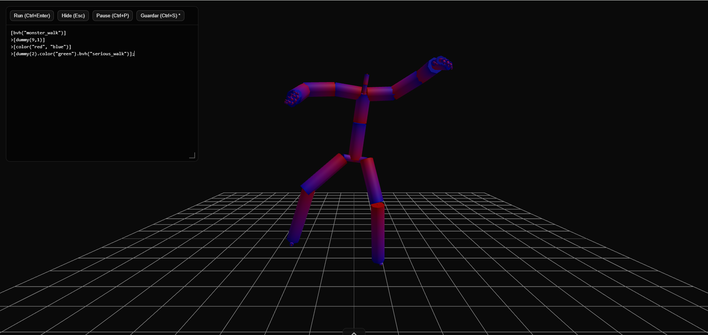

# MoveScript VR

> **Live-code choreography in 3D — from motion capture to WebXR, in real time.**

[](https://movescript.netlify.app/)
[](https://github.com/transper-dev/MoveScript/releases)
[](https://github.com/transper-dev/MoveScript)
[![DeepWiki](https://img.shields.io/badge/-Ask%20DeepWiki-blue.svg?style=flat&labelColor=181717&logo=)](https://deepwiki.com/transper-dev/MoveScript)
[](https://gitdiagram.com/transper-dev/MoveScript)

MoveScript is a creative coding environment that turns human movement into interactive 3D art. Record any motion, convert it to a `.bvh` file, import it, and start sculpting your performance with code: alter time, paint light trails, stack skeletal echoes, and stream the result live to a Meta Quest headset — no graphics engine boilerplate required.



---

## ✨ Key Features

### Fluent Choreographic API

A high-level, chainable language designed for live performance. Transform technical 3D logic into expressive one-liners using the `[bvh()]>` pipe syntax — no scene setup, no asset loading ceremony.

### Skeletal & Geometric Manipulation

Full control over body representation. Render raw bones, switch to a smooth geometric dummy, or overlay concentric bounding-box halos with `box()`. Chain multiple animations back-to-back with seamless position handoff using `CHAIN()` and `nextBvh()`.

### Ghost Trails & Temporal Control

Create motion blur by accumulating translucent skeleton snapshots (`trail()`). Reverse playback, dial in slow-motion or hyperspeed with `speed()`, and introduce delays between dancers. Every parameter is hot-reloadable on the next `Ctrl + Enter`.

### WebXR & VR Streaming

Click one button to open a Pinggy SSH tunnel and share your local scene with any Meta Quest browser in seconds. The headset becomes a live mirror: code changes on your PC are pushed over Socket.IO and rendered instantly inside the headset via WebXR. VR controller positions stream back as OSC messages for use in DAWs or live instruments.

### OSC Bridge

Left and right controller heights are mapped to musical parameters in real time:

- **Left controller Y** → `/vr/left_y` (0–127 volume range)  
- **Right controller Y** → `/vr/right_y` (1000–5000 Hz frequency range)

Sent to `127.0.0.1:12000` at ~60 fps, compatible with Max/MSP, SuperCollider, TouchDesigner, and any OSC-capable software.

### BVH Asset Browser

A slide-up drawer at the bottom of the editor lists all available animations — bundled "global" clips from the repository and "local" clips from your `MoveScript_BVH/` folder. Click any card to instantly inject it into the editor and play it. Hover to preview a GIF. Drag your own `.bvh` files in via the **+ NEW BVH** button.

### Auto-updating Desktop App

The packaged Windows and macOS apps silently check for new releases at startup via `electron-updater`. When an update is found it downloads and applies in the background — no manual reinstall needed.

---

## 🌐 The Web Version

The fastest way to start. No installation required:

**[▶ Open MoveScript in your browser](https://movescript.netlify.app/)**

---

## 🖥️ Desktop Version

For the full experience: offline BVH loading, VR tunnel, and OSC output.

1. Go to the [Releases page](https://github.com/transper-dev/MoveScript/releases).
2. Download the latest `MoveScript Setup.exe` (Windows) or `.dmg` (macOS).
3. Install and run.

---

## 🔗 Network & VR Architecture

Understanding how MoveScript streams to a Meta Quest is key to understanding the project.

```
┌─────────────────────────────────────────────────────┐
│                  Your PC (Electron)                 │
│                                                     │
│  ┌─────────────┐   Socket.IO   ┌─────────────────┐  │
│  │  Code editor│ ─────────────▶│ Express server  │  │
│  │  (index.html│               │  port 3000      │  │
│  │   + CodeMir)│               │  (0.0.0.0)      │  │
│  └─────────────┘               └────────┬────────┘  │
│                                         │            │
│                               SSH tunnel (Pinggy)   │
│                                         │            │
└─────────────────────────────────────────┼────────────┘
                                          │ public HTTPS URL
                                          ▼
                               ┌─────────────────────┐
                               │   Meta Quest browser │
                               │   visor.html (WebXR) │
                               │   Socket.IO client   │
                               └─────────────────────┘
                                          │
                               VR controller data
                               (Socket.IO → OSC)
                                          ▼
                               ┌─────────────────────┐
                               │  DAW / OSC listener  │
                               │  127.0.0.1:12000     │
                               └─────────────────────┘
```

### Step by step

1. **Local server** — When Electron starts, `main-electron.js` creates an Express + Socket.IO server bound to `0.0.0.0:3000`. It serves the 3D viewer (`visor.html`), Three.js from `node_modules`, and `.bvh` files from both the bundled `assets/bvh/` folder and the user's local `MoveScript_BVH/` directory.

2. **VR Tunnel** — Clicking the VR button in the UI sends an Electron IPC message (`iniciar-tunel-vr`) to the main process, which spawns a terminal running:

   ```
   ssh -p 443 -R0:127.0.0.1:3000 -o StrictHostKeyChecking=no qr@a.pinggy.io
   ```

   [Pinggy](https://pinggy.io/) creates an SSH reverse tunnel that exposes your `localhost:3000` under a public `https://*.pinggy.io` URL. The terminal window shows the URL to type into the headset browser. Closing the terminal emits `tunel_cerrado` back to the UI.

3. **Headset viewer** — `visor.html` is a pure WebXR page. It connects to Socket.IO using a relative URL, so it works both as a localhost iframe (in the PC editor) and as a remote page accessed via the Pinggy URL on the Quest. The server detects the `OculusBrowser` / `Quest` User-Agent and broadcasts a `vr_status: connected` event to the PC UI.

4. **Code sync** — When the user runs their script (`Ctrl + Enter`), the PC editor emits `update_code` over Socket.IO. The server re-broadcasts it as `execute_code` to all connected clients. The headset's `visor.html` receives it and calls `new Function(code)()`, executing the MoveScript DSL inside `bvhApi.js`, which redraws the 3D scene in place — including inside an active WebXR session.

5. **VR data return path** — Inside a WebXR session, `bvhApi.js` reads both controllers' world positions and rotations every other frame and posts them to `visor.html` via `window.parent.postMessage`. `visor.html` emits these as `vr_data` events over Socket.IO. Back on the PC, a 16 ms timer flushes the most recent snapshot to the OSC client (`node-osc` → `127.0.0.1:12000`).

---

## 🎮 Editor Controls

| Action | Shortcut |
| --- | --- |
| Run code | `Ctrl + Enter` |
| Hide/show editor | `Esc` |
| Pause scene | `Ctrl + P` |
| Save | `Ctrl + S` |
| Drag editor | Click & drag title bar |
| Resize editor | Bottom-right corner handle |

**3D viewer interactions**

- **Orbit** — left-click drag  
- **Zoom** — scroll wheel  
- **Click a dancer** — select it (yellow bounding box); click again to switch to rotation mode (cyan box)  
- **Arrow keys** on selected dancer — move (5 units) or rotate (0.1 rad); hold `Shift` for larger steps

---

## 📖 API Reference

### Scene Setup

```javascript
clear()                        // Wipe the entire scene and reset all state
grid(size, divisions)          // Add a floor grid (default: 400, 10)
floor(color, size)             // Add an opaque floor plane
cam(x, y, z, lookX, lookY, lookZ) // Position and aim the camera
bg(color)                      // Set background color: bg("#000105")
rot(speed)                     // Auto-rotate the entire scene
```

### Loading Animations

```javascript
bvh("walk")                    // Load walk.bvh — local first, CDN fallback
bvh("https://...")             // Load any public URL directly
```

### Chaining (Pipe Syntax)

```javascript
[bvh("intro")]
>[bvh("loop")]                 // intro plays, then loop plays (sequential)
>[dummy()]                     // switch to geometric dummy for the chain
>[color("red", "blue")]        // gradient red → blue across all bones
>[trail(30)]                   // 30-frame ghost trail
```

### Per-Dancer Modifiers

All modifiers are chainable:

```javascript
bvh("walk").pos(100, 0, 0)     // offset position
           .rotY(1.57)         // rotate 90° on Y axis
           .scale(1.5)         // 1.5× scale
           .speed(0.5)         // slow-motion
           .reverse()          // play backwards
           .color("cyan")      // solid color
           .color("red","blue") // gradient
           .trail(20)          // light trail length
           .skeleton(false)    // hide wireframe skeleton
           .dummy()            // show geometric body
           .bones(2, 1.2)      // cylinder thickness, length multiplier
           .joints(3)          // sphere joint size
           .box(5, 0.4)        // 5 concentric bounding boxes
           .delay(2)           // start 2 seconds after the others
```

### Animation Sequences

```javascript
CHAIN(
  $B().bvh("pose_a").delay(3), // hold pose_a for 3 s
  $B().bvh("walk"),            // then walk
  $B().bvh("pose_b").delay(2)  // hold pose_b for 2 s
)
```

### Duplication

```javascript
const dancer = bvh("walk").color("white").trail(10);
duplicate(dancer).pos(200, 0, 0).color("red"); // independent copy
```

### Global Controls

```javascript
speed(0.5)    // halve playback speed for all dancers
pause()       // freeze all animations
skeleton(false) // hide all wireframe skeletons globally
scale(2)      // double all scale globally
color("gold") // tint all dancers gold
trail(40)     // enable trails globally
```

---

## 🛠️ Developer Guide

### Instant Code Exploration (Zero-Install)

Explore, search, or feed MoveScript into an AI assistant directly from your browser without cloning the repository:

| Tool | Purpose | Link |
| --- | --- | --- |
| **VS Code Web** | Open the full codebase in a browser-based VS Code editor | [](https://github.dev/transper-dev/MoveScript) |
| **DeepWiki** | Ask AI questions about `bvhApi.js`, WebXR, or OSC logic | [![DeepWiki](https://img.shields.io/badge/-Ask%20DeepWiki-blue.svg?style=flat&labelColor=181717&logo=)](https://deepwiki.com/transper-dev/MoveScript)|
| **GitDiagram** | Navigate the system architecture via interactive nodes | [](https://gitdiagram.com/transper-dev/MoveScript) |
| **GitIngest** | Pack the entire repository into a single LLM-ready `.txt` prompt | [](https://gitingest.com/transper-dev/MoveScript) |

### Prerequisites

- [Node.js](https://nodejs.org/) 18+
- Git

### Run locally

```bash
# 1. Clone
git clone https://github.com/transper-dev/MoveScript.git
cd MoveScript

# 2. Install dependencies
npm install

# 3. Start the Electron app in development mode
npm start
```

`npm start` runs `node generar-lista.js` first (rebuilds the BVH asset index), then launches Electron.

### Add your own BVH files

Drop `.bvh` files into `MoveScript_BVH/` (created automatically next to the executable, or at `~/Documents/MoveScript_BVH/` on macOS). They appear immediately in the BVH Drawer as "Local" files.

### Build distributable packages

```bash
# Windows (.exe installer + .zip)
npm run build:win

# macOS (.dmg + .zip)
npm run build:mac

# Both platforms
npm run build:all
```

Build output lands in `dist/`. The Windows build produces an NSIS one-click installer with optional custom install path.

### Publish a release with auto-update

```bash
npm run release
```

This builds and uploads the packages to the GitHub Releases page of the repo configured in `package.json` (`transper-dev/Movescript`). Users running any previous version will receive a silent background update the next time they open the app.

---

## 🔄 Auto-Update System

The desktop app uses [`electron-updater`](https://www.electron.build/auto-update) backed by GitHub Releases.

**How it works:**

1. On startup, the packaged app calls `autoUpdater.checkForUpdatesAndNotify()`.
2. `electron-updater` fetches the latest release metadata from the GitHub Releases API.
3. If a newer version exists, the installer/delta package is downloaded silently in the background.
4. The user is notified and prompted to restart, or the update applies on the next launch.

**Development mode** (`npm start`) deliberately skips the updater — `app.isPackaged` is `false`, so `checkForUpdatesAndNotify()` is never called. This prevents false update prompts during development.

To cut a new release, bump the version in `package.json` and run `npm run release`.

---

## 📦 Tech Stack

| Layer | Technology |
| --- | --- |
| Desktop shell | [Electron](https://www.electronjs.org/) v42 |
| Local server | [Express](https://expressjs.com/) v5 |
| Real-time sync | [Socket.IO](https://socket.io/) v4 |
| 3D rendering & WebXR | [Three.js](https://threejs.org/) r159 |
| Motion capture format | BVH (Biovision Hierarchy) |
| Live code editor | [CodeMirror](https://codemirror.net/) v5 (Monokai) |
| VR tunnel | [Pinggy](https://pinggy.io/) SSH reverse proxy |
| Sound control | [OSC](http://opensoundcontrol.org/) via `node-osc` |
| Auto-update | [electron-updater](https://www.electron.build/auto-update) |
| Packaging | [electron-builder](https://www.electron.build/) |

---

## License

ISC © [Urki Aristu - Transper](https://github.com/transper-dev)
